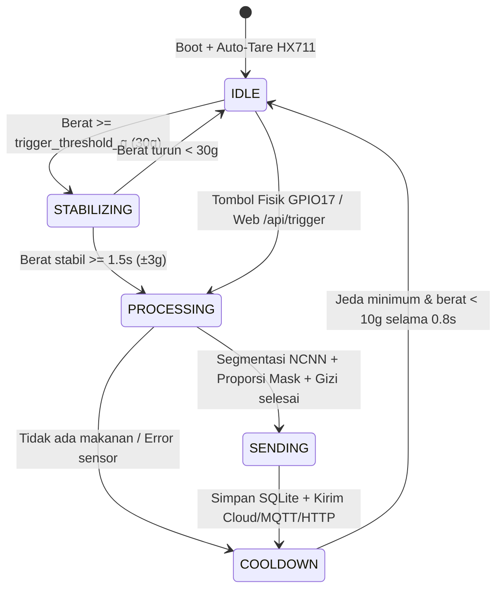

# NutriScan IoT – Raspberry Pi 4 (64-bit)

Sistem Edge AI & IoT **NutriScan MBG** untuk mendeteksi menu makanan Makan Bergizi Gratis (39 kelas) menggunakan model segmentasi **YOLO26n-seg (NCNN)** di **Raspberry Pi 4 (Raspberry Pi OS 64-bit)** yang terintegrasi otomatis dengan sensor berat **Load Cell (HX711)**, penyimpanan **SQLite WAL offline-first**, sinkronisasi cloud (**Supabase / HTTP REST / MQTT**), serta **Web Dashboard lokal**.

Repositori ini menggabungkan:
- **Engine AI & Kalkulasi Gizi** dari `model-mbg` (`yolo/detect.py` + `classes_nutritions.csv` + bobot NCNN `640` & `416`).
- **Arsitektur Hardware, CPU Core-Pinning, & Offline-First Runtime** dari `dish-counter-apparatus`.

---

## Arsitektur & Alur State-Machine



### Pemetaan CPU Core Pinning (Raspberry Pi 4 Quad-Core)
- **Core 0 (`MainThread` / `WebThread`)**: Orchestrator utama & Flask Dashboard (`:5000`).
- **Core 1 (`CamThread`)**: Pengambilan frame Pi Camera (`picamera2`) / USB Webcam MJPEG.
- **Core 2 (`SensorThread`)**: Polling Load Cell HX711, *trimmed-mean outlier filter*, dan monitor stabilitas.
- **Core 3 (`AIThread`)**: Inferensi segmentasi NCNN & kalkulasi nutrisi per komponen.

---

## Pilihan Model NCNN (`YOLO26n-seg`)

| Varian Model | Lokasi Folder | Mask mAP50 | Mask mAP50-95 | Karakteristik |
|---|---|---:|---:|---|
| `640` (default) | `models/best_640_ncnn_model/` | 0.975 | 0.892 | Akurasi segmentasi tertinggi |
| `416` | `models/best_416_ncnn_model/` | 0.969 | 0.830 | ~2x lebih cepat di CPU Raspberry Pi 4 |

Ubah `model.variant` (`"640"` atau `"416"`) sekaligus `model.imgsz` (`640` atau `416`) di `data/config.json`. Nilai `imgsz` divalidasi otomatis terhadap `metadata.yaml` di folder NCNN saat startup.

---

## Wiring Hardware (Load Cell → HX711 → Raspberry Pi 4)

> [!CAUTION]
> **WAJIB 3.3V, JANGAN 5V!** Pin GPIO Raspberry Pi 4 bekerja pada level tegangan **3.3V** (tidak *5V-tolerant*). Menghubungkan `VCC` modul HX711 ke pin 5V dapat merusak pin GPIO Raspberry Pi secara permanen. Gunakan **Pin 1 (3.3V Power)**!

### 1. Load Cell (4 Kabel) → HX711
| Kabel Load Cell | Terminal HX711 | Keterangan |
|---|---|---|
| Merah (`E+`) | `E+` | Eksitasi + |
| Hitam (`E-`) | `E-` | Eksitasi - |
| Putih (`A-`) | `A-` | Sinyal jembatan - |
| Hijau (`A+`) | `A+` | Sinyal jembatan + |

### 2. HX711 & Tombol Fisik → Raspberry Pi 4 (40-Pin Header)
| Pin Modul | Pin BCM Raspberry Pi 4 | Pin Fisik Header | Konfigurasi `data/config.json` |
|---|---|---|---|
| `VCC` | **3.3V Power** | **Pin 1** | — |
| `GND` | **Ground** | **Pin 6** (atau Pin 9/34) | — |
| `DT` (`DOUT`) | **GPIO 5** | **Pin 29** | `hardware.pin_loadcell_dt: 5` |
| `SCK` (`PD_SCK`) | **GPIO 6** | **Pin 31** | `hardware.pin_loadcell_sck: 6` |
| Tombol Manual *(opsional)* | **GPIO 17** ↔ **GND** | **Pin 11** ↔ **Pin 9** | `hardware.pin_tombol: 17` |

---

## Instalasi di Raspberry Pi 4 (OS 64-bit)

Jalankan skrip instalasi otomatis (memasang `python3-picamera2`, `python3-lgpio`, membuat `.venv --system-site-packages`, serta menyalin `data/config.json` & `.env`):

```zsh
cd nutriscan-iot-raspi
chmod +x scripts/install.sh scripts/run.sh deploy/setup_autostart.sh
./scripts/install.sh
```

Cek kesiapan paket, model NCNN, dan CSV nutrisi:

```zsh
source .venv/bin/activate
python3 scripts/check_env.py
```

---

## Kalibrasi Load Cell HX711

Sebelum produksi, wajib kalibrasi faktor skala (`reference_unit`) menggunakan benda yang beratnya diketahui pasti (misal air mineral 600 g atau anak timbangan 500 g):

```zsh
source .venv/bin/activate
python3 scripts/calibrate_hx711.py
```

Skrip akan memandu:
1. Mengukur offset nol (`tare`) saat piring/nampan kosong.
2. Menimbang benda referensi untuk menghitung `reference_unit = (raw_beban - raw_kosong) / berat_gram`.
3. Menyimpan nilai `loadcell.reference_unit` dan `loadcell.tare_offset` secara otomatis ke `data/config.json`.

Untuk mencoba alur kalibrasi di laptop tanpa hardware:

```zsh
python3 scripts/calibrate_hx711.py --mock --no-save
```

---

## Konfigurasi Produksi (`data/config.json` & `.env`)

1. Salin `data/config.example.json` → `data/config.json` (otomatis dibuat oleh `install.sh`).
2. Ubah `"environment": "production"` saat dijalankan di Raspberry Pi fisik agar sistem langsung memberi error eksplisit jika sensor HX711 terputus.
3. Simpan semua token/password di `.env` (`chmod 600 .env`), **bukan** di `data/config.json`:

```zsh
cp .env.example .env
chmod 600 .env
nano .env
```

### Mode Sinkronisasi IoT (`sync`)
Semua hasil scan selalu disimpan terlebih dahulu ke **SQLite WAL** (`data/nutriscan.db`) sebelum dikirim ke jaringan, sehingga aman apabila Wi-Fi/internet dapur terputus:
- **Supabase (`sync.supabase.enabled: true`)**: Upsert ke tabel `nutriscan_scans` berdasarkan `scan_uuid` via `NUTRISCAN_SUPABASE_URL` & `NUTRISCAN_SUPABASE_KEY`.
- **HTTP REST (`sync.http.enabled: true`)**: POST `multipart` (payload JSON + JPEG) atau `json` (+ `image_base64`) dengan header `Authorization: Bearer $NUTRISCAN_HTTP_TOKEN`.
- **MQTT Broker (`sync.mqtt.enabled: true`)**: Publish ke topik `nutriscan/{device_id}/telemetry` dengan QoS 1 & opsional TLS.

---

## Testing & Simulasi di Laptop / PC (Tanpa Hardware)

Jalankan 1 siklus penuh (`IDLE -> STABILIZING -> PROCESSING -> SENDING -> COOLDOWN -> IDLE`) menggunakan simulator kamera, HX711, dan model:

```zsh
python3 main.py --mock --once --no-web
```

Jalankan seluruh unit & integration test beserta laporan coverage:

```zsh
PYTHONPATH=src python3 -m pytest tests/ --cov=src/nutriscan --cov=scripts.calibrate_hx711 --cov-report=term-missing
```

---

## Deployment Otomatis (`systemd`)

Pasang service agar NutriScan berjalan otomatis saat Raspberry Pi 4 menyala:

```zsh
./deploy/setup_autostart.sh
sudo systemctl start nutriscan
sudo journalctl -u nutriscan -f
```

Web Dashboard lokal dapat diakses melalui browser di jaringan lokal pada `http://<IP_RASPBERRY_PI>:5000`.
